# 🌾 KisaanAI — کسان اے آئی

**A multi-agent crop doctor for Pakistani farmers.** Send a photo of a sick leaf and an Urdu voice note. Five AI agents diagnose the problem, look up treatments in a sourced knowledge base, check them for safety and weather, and reply in **spoken Urdu**.

---

## Submission details

| Field | Value |
|---|---|
| Project Screenshots Link | **TODO:** paste the Google Drive / image link here (set access to *Anyone with the link can view* and test it) |
| GitHub / Repository Link | **TODO:** `https://github.com/<user>/<repo>` |
| Live demo (optional) | **TODO:** Render URL, if deployed |
| Repository access | ☐ I confirm that my repository is publicly accessible or that the judging panel has been granted the necessary access. *(tick this box before submitting)* |

### README checklist → where to find it

| Checklist item | Section |
|---|---|
| Problem statement and solution | [1](#1-problem-statement-and-solution) |
| Technology stack | [2](#2-technology-stack) |
| Setup and installation instructions | [3](#3-setup-and-installation) |
| AI methodology and implementation | [4](#4-ai-methodology-and-implementation) |
| AI model names and API usage | [5](#5-ai-model-names-and-api-usage) |
| Product screenshots | [6](#6-product-screenshots) |
| Team member contributions | [9](#9-team-member-contributions) |

---

## 1. Problem statement and solution

### The problem
When a smallholder farmer sees spotted, curled or yellowing leaves, they must decide quickly **what is wrong and what to spray**. Help is often hard to reach, is rarely available in the farmer's own language, and a wrong or unsafe pesticide costs money, can damage the crop and harms health. Many farmers also read little, so a text-only app does not help them.

A general-purpose AI chatbot is not enough either: it can sound confident while inventing a dose or a product name, which is dangerous when the answer is a chemical.

### The solution
KisaanAI lets the farmer **speak and show** instead of type and read:

1. The farmer uploads a **leaf photo** and records an **Urdu voice note** (or types the problem; Roman Urdu works too).
2. Five cooperating agents **diagnose** the problem, **research** the treatment, **verify** it and **explain** it.
3. The farmer gets an **Urdu audio answer** plus on-screen cards with the diagnosis, treatment options, doses, sources and a spray-timing warning based on the local weather.

**The core design rule: the system must never invent a medicine or a dose.** Every treatment is labelled with where it came from:

| Label in the UI | Meaning |
|---|---|
| ✅ **Verified** | Comes from the reviewed knowledge base (`knowledge/`), and every dose, ingredient and brand was checked against the cited source text. |
| ⚠️ **Unverified (web)** | Found by a web search limited to allow-listed agriculture sites. Dose is shown on screen only, never read out in the audio. |
| ⚠️ **AI general knowledge** | Last resort when nothing else exists. No dose, brand, price or number is allowed. Always flagged "confirm with an agriculture officer or inspector". |

If the system is not sure about the photo, it says so and asks for a clearer picture instead of guessing.

### Main features
- 🎙️ Urdu voice notes (record in the browser or upload audio) or typed text
- 📷 Photo upload with automatic downscaling to save tokens
- 🧠 Five-agent pipeline with a live "agents working" stepper
- 🔊 Spoken Urdu answer (text-to-speech) with Urdu text on screen
- 🛡️ Safety verification, with a visible "Verifier blocked N suggestions" badge
- ☔ Weather-aware spray warnings (rain, wind, heat) for 12 districts
- 💊 Medicines catalogue, precautions page, history and a "How it works" page
- 🌐 Optional online medicine search (clearly marked unverified)

---

## 2. Technology stack

| Layer | Technology |
|---|---|
| Backend | Python 3.10+, **FastAPI**, Uvicorn, `python-multipart`, `httpx` |
| Frontend | Plain **HTML + CSS + JavaScript** (no framework), served by FastAPI. Urdu right-to-left support with Noto Nastaliq Urdu |
| LLM / speech-to-text / vision | **Groq API** (see [section 5](#5-ai-model-names-and-api-usage)) |
| Retrieval (RAG) | **scikit-learn** TF-IDF over the knowledge base text files |
| Web search (optional) | **Tavily** API, restricted to allow-listed domains |
| Weather | **Open-Meteo** (free, no key) |
| Text-to-speech | **edge-tts** (Microsoft Edge online voices, no key) |
| Image handling | **Pillow** |
| Config | `python-dotenv` (`.env` file) |
| Deployment | Any host that runs Uvicorn, for example **Render** |

---

## 3. Setup and installation

### Prerequisites
- Python **3.10 or newer**
- A **Groq API key** (required): <https://console.groq.com>
- A **Tavily API key** (optional, only enables the restricted web-search fallback): <https://tavily.com>
- A modern browser. The microphone only works on `localhost` or HTTPS.

### 1. Get the code
```bash
git clone https://github.com/<user>/<repo>.git
cd <repo>
```

### 2. Create a virtual environment and install packages

**Windows (PowerShell)**
```powershell
python -m venv venv
.\venv\Scripts\Activate.ps1
pip install -r requirements.txt
```

**macOS / Linux**
```bash
python3 -m venv venv
source venv/bin/activate
pip install -r requirements.txt
```

### 3. Add your API keys
Create a file named `.env` in the project folder (it is git-ignored, never commit it):
```env
GROQ_API_KEY=your_groq_key_here
TAVILY_API_KEY=your_tavily_key_here   # optional
```

### 4. Run
```bash
uvicorn main:app --reload
```
Open <http://localhost:8000>. Check that the server sees your key: <http://localhost:8000/health> should return `{"app":"kisaanai","ok":true,"key":true}`.

If the page opens in **Demo mode**, the dashboard could not reach the backend. Demo mode shows a sample result with a "Demo" badge and does not use any AI.

### Deploy on Render
- **Build command:** `pip install -r requirements.txt`
- **Start command:** `uvicorn main:app --host 0.0.0.0 --port $PORT`
- **Environment variables:** `GROQ_API_KEY` (and optionally `TAVILY_API_KEY`)

### Environment variables

| Variable | Default | Purpose |
|---|---|---|
| `GROQ_API_KEY` | — (required) | Groq access |
| `TAVILY_API_KEY` | — (optional) | Enables the web-search fallback |
| `KISAAN_WEB_SEARCH` | `1` | Set to `0` to switch web search off |
| `KISAAN_WEB_DOMAINS` | PARC, Punjab Agriculture, UAF, ACIAR, CABI, Plantwise, researcherslinks | Comma-separated allow-list for web search |
| `KISAAN_DIAG_RUNS` | `3` | Maximum number of photo analyses used for the vote |
| `KISAAN_MAX_PARALLEL` | `2` | Diagnoses processed at the same time (protects Groq limits) |
| `KISAAN_TEXT_MODEL` | `openai/gpt-oss-120b` | Research and verifier model |
| `KISAAN_URDU_MODEL` | `openai/gpt-oss-120b` | Listener and Urdu translation model |
| `KISAAN_VISION_MODEL` | `qwen/qwen3.8-27b` | Photo diagnosis model |
| `KISAAN_STT_MODEL` | `whisper-large-v3` | Speech-to-text model |
| `KISAAN_TTS_VOICE` | `ur-PK-UzmaNeural` | Urdu voice (`ur-PK-AsadNeural` is the male voice) |
| `KISAAN_OTPM_LIMITS` | `{}` | JSON map of output-token-per-minute limits per model |

### Project structure
```
.
├── main.py                  # FastAPI server: /health, /diagnose, /api/search-medicine, static dashboard
├── agents.py                # The five agents, safety checks, rate-limit handling, orchestrator
├── banned_pesticides.json   # Banned / restricted active ingredients (starter list)
├── knowledge/               # Sourced text files used for retrieval (one SOURCE line per file)
│   ├── citrus_canker_sargodha_trial.txt
│   ├── citrus_calendar_aciar.txt
│   └── pakistan_crop_kb.txt
├── web/                     # Dashboard: index.html, script.js, styles.css, data.js
├── requirements.txt
└── .gitignore
```

---

## 4. AI methodology and implementation

### Pipeline overview

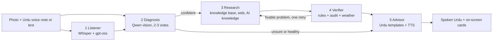

The orchestrator (`run_pipeline` in `agents.py`) records every agent's input, output and time. The dashboard shows them live and in the "Agent activity" trace.

### The five agents

**1. Listener.** Whisper `large-v3` transcribes the Urdu voice note (`language="ur"`). A language model turns the transcript into structured JSON: crop, symptoms, duration, urgency and the farmer's question. Typed text can be used instead of, or together with, the voice note.

**2. Diagnosis.** The photo is downscaled to at most 1024 px and sent to a vision model. To avoid trusting one lucky answer, the photo is analysed **twice in parallel**; a **third** analysis runs only when the first two disagree. The answers are put to a **majority vote** on the disease name.
- *Likely* is claimed only when at least two thirds of the runs agree **and** the average confidence is at least 0.80.
- If the runs disagree, or confidence is below 0.60, the farmer is told the system is **not sure**, asked for a clearer close-up, and **no treatment is suggested**.
- The AI's own confidence figure is shown as "the AI's own estimate", never as a lab result.

**3. Research.** The agent looks for treatments in three tiers, and stops at the first tier that gives something the Verifier approves:
1. **Knowledge base (RAG).** Every paragraph in `knowledge/*.txt` is one chunk. TF-IDF (unigrams and bigrams) retrieves the top passages for the diagnosed crop and disease (`ALIAS:` lines map other disease names to the names used in the knowledge base). The model may recommend **only what is written in the retrieved passages**; dose, brand and price are `null` unless the source states them.
2. **Web search (optional).** If the knowledge base has nothing usable and `TAVILY_API_KEY` is set, Tavily searches **only allow-listed domains**. Results are tagged `origin: "web"` and are shown as unverified.
3. **AI general knowledge (last resort).** The model may name up to two commonly accepted control options. Numbers, doses, brands and prices are forbidden, the banned list is applied, and a second model call must confirm the option fits this disease. Always tagged `origin: "ai"` and unverified.

**4. Verifier.** Nothing reaches the farmer unless it passes these checks (fail-closed):

| Check | What it does |
|---|---|
| Banned list | Rejects any banned or restricted ingredient found in *any* field (action, ingredient, dose, brand, price). Whole-word matching. |
| Grounding (code, not a model) | The active ingredient, each dose amount **with its unit**, brand names, price and any number in the action text must literally appear in the cited source. A dose must sit in the same sentence as its own ingredient (or in a paragraph that names only that ingredient), so a number belonging to another product cannot be borrowed. |
| LLM audit | A second model call judges (a) whether the source really says this treatment works for this disease and (b) whether it is sensible and non-dangerous. A missing dose is normal and is never a reason to reject. The recommendation is approved **only if both answers are explicitly true**; a missing verdict or an error means rejection. |
| One correction retry | If something is rejected for a fixable reason, Research tries once more, **reusing the same passages** (no new retrieval and no new network call). |
| Weather | Open-Meteo forecast for the farmer's district: warns if rain probability is 50% or more, wind is above 20 km/h, or the maximum temperature is above 38 °C. |

**5. Advisor.** The Urdu answer is **built mostly by code, not free-written by a model**, to prevent hallucinated advice:
- The diagnosis sentence, disease names, weather warnings and the safety closing (gloves, mask, keep away from children, read the label…) are **fixed, human-written Urdu**.
- For each treatment, the **dose sentence is generated from the numbers by code** (for example "3 g in 10 L water" becomes the Urdu sentence for 10 litres of water with 3 grams), and units are written as Urdu words.
- A model only **translates one short action sentence at a time**. If its translation contains a number that was not in the English sentence, that item is replaced by a plain "<ingredient> spray".
- A final check rejects any script with an unexpected number or a banned ingredient name; a fixed safe message is used instead.
- Web and AI-knowledge items never have a dose, brand or price spoken, and a fixed warning to confirm with an officer or inspector is added.
- Only the first 3 treatments are read aloud (`MAX_SPOKEN`); all of them stay on screen.
- Text-to-speech (`edge-tts`, Pakistani Urdu voice) produces an MP3 that is streamed back to the browser.

### Reliability and rate limits
- A per-model **token budget manager** paces Groq calls, learns limits from API error messages, reads `retry-after` hints, and stops quickly with a clear message when a daily limit is reached.
- The API key is held per request and is never written to the process environment or sent to the browser.
- Uploaded audio and generated MP3 files are handled in memory or temporary files and deleted after use.

### Knowledge base format
Each `knowledge/*.txt` file starts with one `SOURCE:` line (real document and link). Paragraphs are separated by blank lines. Optional `URDU_NAME: English name = اردو نام` lines give the spoken Urdu disease name, and `ALIAS: other name = KB name` lines map synonyms. A dose, brand or price is written **only if the source states it**.

### Knowledge sources

| File | Source |
|---|---|
| `citrus_canker_sargodha_trial.txt` | Rehman, M.A., Ali, S., Afzal, M.B.S., Khan, M.N. and Ali, M. (2020). *Efficacy of Chemicals and Botanical Extracts to Control Citrus Canker on Kinnow in Sargodha Region.* Vol. 6, Issue 2, pp. 101–107. <https://researcherslinks.com/current-issues/Efficacy-of-Chemicals-and-Botanical-Extracts/27/1/3448> |
| `citrus_calendar_aciar.txt` | Ali, W., Falivene, S., Donovan, N., Tahir, T. and Khurshid, T. (Sept 2015). *Pakistan Citrus Management Calendar.* Australia-Pakistan Agriculture Sector Linkages Program (ASLP II and NSW DPI). <https://dev-research.aciar.gov.au/aik-saath/sites/_co-lab.aciar.gov.au.aik-saath/files/2020-09/Pakistan%20citrus%20calender.pdf> |
| `pakistan_crop_kb.txt` | Crop–disease–treatment entries for 20 diseases of 9 crops (cotton, rice, wheat, tomato, citrus, mango, sugarcane, potato, chickpea). **TODO: add the real document name and link for this data, or state clearly that it is a draft that has not been checked against an official source.** |
| `web/data.js` (Medicines page) | Product names, pack sizes and approximate prices. **TODO: state where the product and price data came from and the date it was collected.** Prices are shown as "approx., check your shop". |

---

## 5. AI model names and API usage

| Service | Model / endpoint | Used for | Key needed |
|---|---|---|---|
| **Groq** audio transcription | `whisper-large-v3` (`audio.transcriptions`, `language="ur"`) | Urdu speech-to-text | `GROQ_API_KEY` |
| **Groq** chat completions (JSON mode) | `openai/gpt-oss-120b` | Listener extraction, research, verifier audit, AI-knowledge tier and its check, Urdu sentence translation, disease-name translation | `GROQ_API_KEY` |
| **Groq** vision chat completions | `qwen/qwen3.8-27b` | Leaf photo diagnosis (2–3 parallel runs, majority vote) | `GROQ_API_KEY` |
| **Tavily** | `POST https://api.tavily.com/search` | Restricted web-search fallback; also the "Online Search" button on the Medicines page | `TAVILY_API_KEY` (optional) |
| **Open-Meteo** | `https://api.open-meteo.com/v1/forecast` | 2-day rain, wind and temperature forecast per district | none |
| **edge-tts** | `ur-PK-UzmaNeural` | Urdu text-to-speech (MP3) | none |

Model names can be changed with the `KISAAN_*_MODEL` environment variables if Groq renames or retires a model.

### The app's own HTTP API

| Endpoint | Description |
|---|---|
| `GET /health` | `{"app":"kisaanai","ok":true,"key":<bool>}`; the dashboard uses it to choose live or demo mode |
| `POST /diagnose` | `multipart/form-data`: `image` (≤ 8 MB), `audio` (optional, ≤ 12 MB), `typed_text`, `district`. Responds with a **newline-delimited JSON stream** of `step`, `result` and `error` events, so the dashboard can animate each agent. The `result` contains the diagnosis, verified recommendations, rejected suggestions, Urdu script, English summary, base64 MP3 and the agent trace. |
| `POST /api/search-medicine` | JSON `{"query": "..."}`; returns a Tavily summary and result links, shown as **unverified**. |

Supported districts for the weather check: Lahore, Faisalabad, Multan, Bahawalpur, Sargodha, Sahiwal, Hyderabad, Sukkur, Larkana, Peshawar, Mardan, Quetta.

---

## 6. Product screenshots

| | |
|---|---|
| 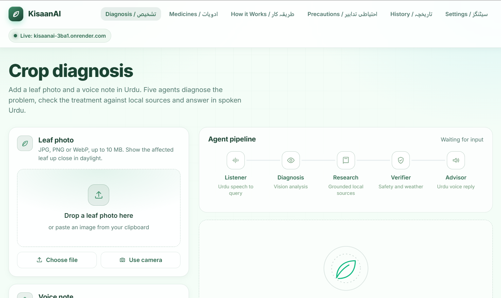 | 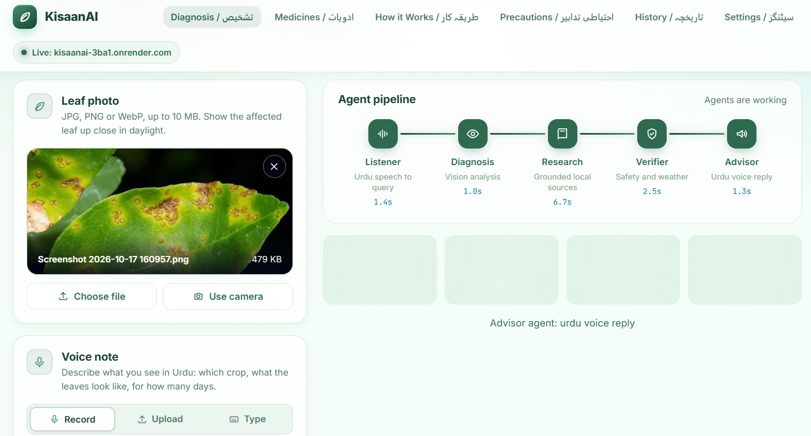 |
| *Diagnose: photo, voice note and district* | *The five agents working live* |
| 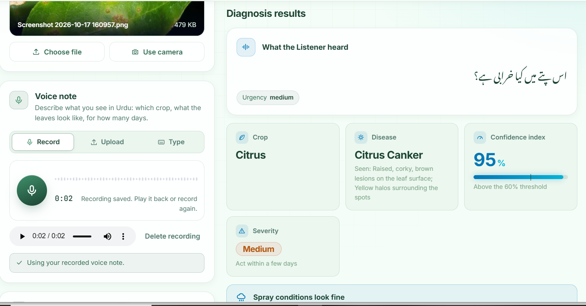 | 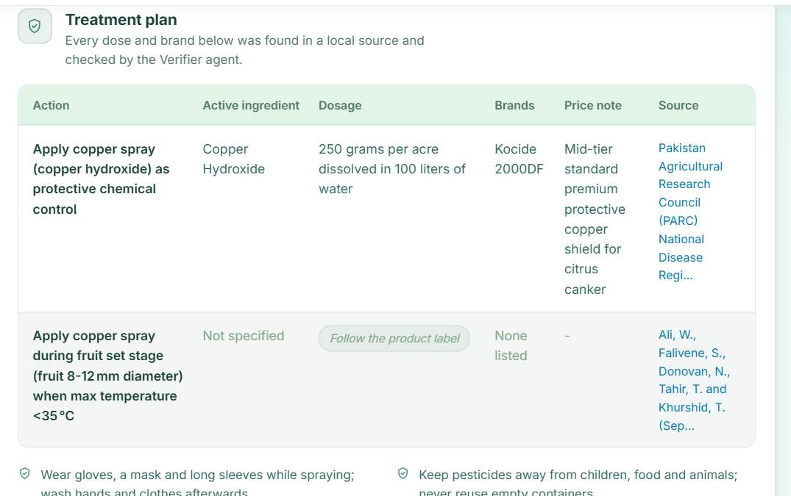 |
| *Diagnosis with the AI's own estimate and other possibilities* | *Verified treatments with sources (PARC, ACIAR)* |
| 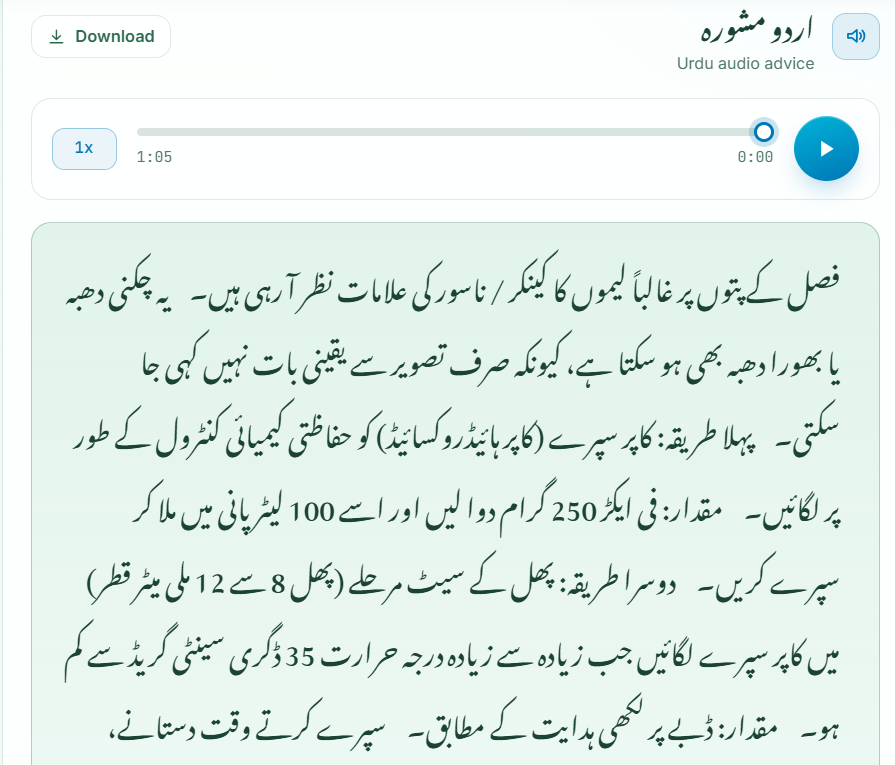 | 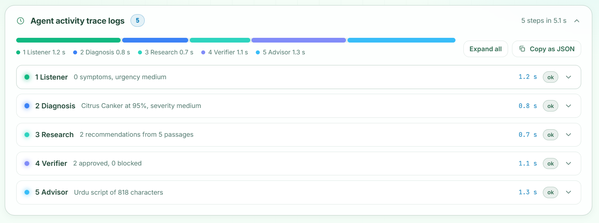 |
| *Spoken Urdu advice and text* | *Agent activity trace (inputs and outputs)* |
| 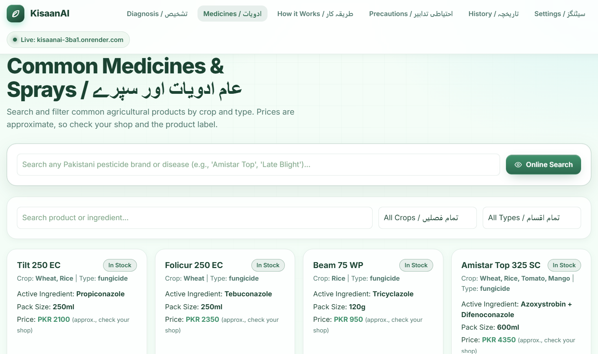 | 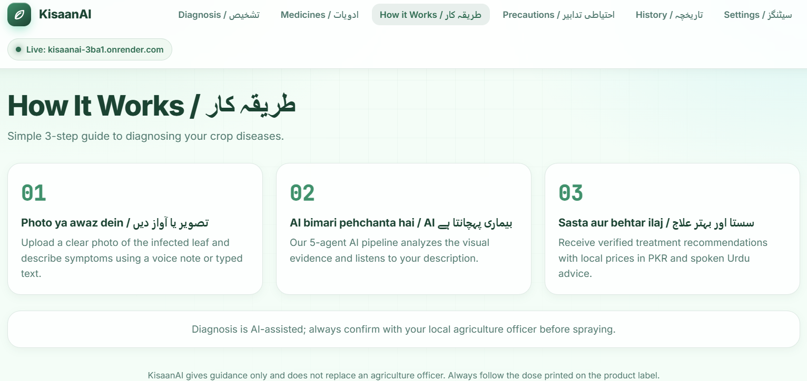 |
| *Medicines catalogue and online search* | *How it works page* |
| 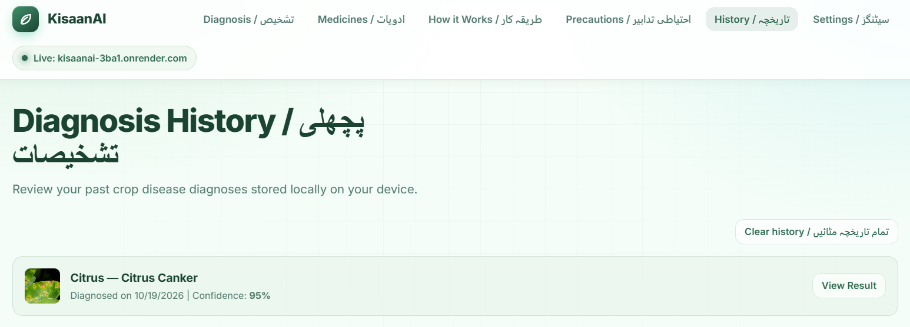 | 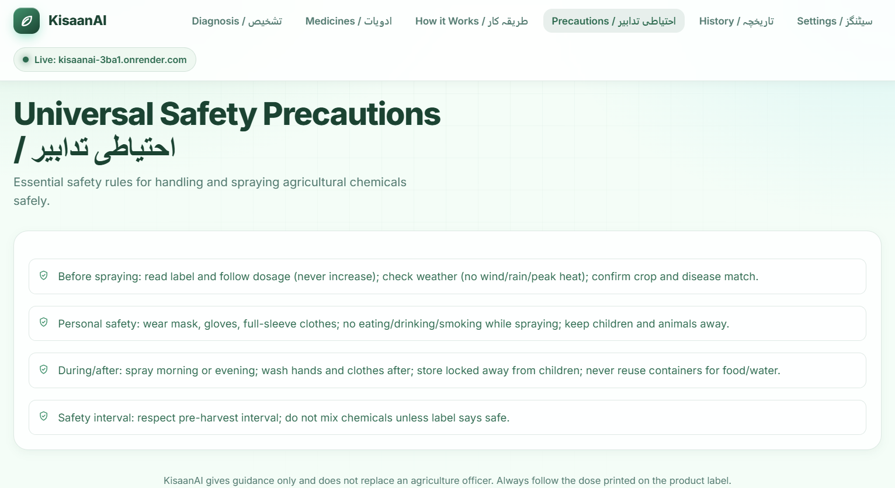 |
| *Diagnosis history* | *Universal precautions* |
| 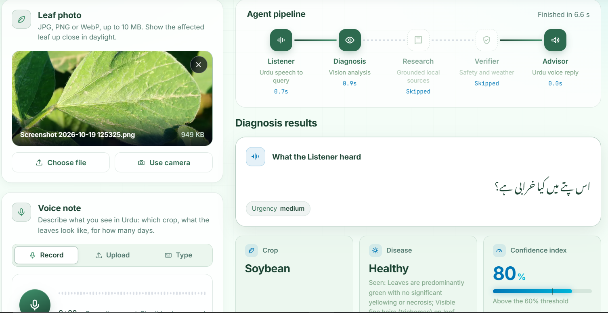 | |
| *Healthy plant detection (skips treatment)* | |

---

## 7. Safety, limitations and responsible use

- **AI guidance only.** KisaanAI is not a substitute for an agriculture officer. The dose on the **product label always wins**.
- **A photo cannot settle a diagnosis.** Several diseases look alike, so the app shows other possibilities and asks the farmer to confirm with an officer. Diagnosis accuracy has not been formally benchmarked.
- **"Verified" means "written in the cited source and checked by code"**, not "registered for sale in Pakistan". Rates in research papers come from field trials and can differ from a product label.
- **The banned list is a starter list** of globally banned persistent pesticides (DDT, endosulfan, aldrin, dieldrin, endrin, chlordane, heptachlor, lindane, hexachlorobenzene, mirex, toxaphene). It should be extended with the national list of restricted pesticides.
- **Unverified tiers.** Web and AI-knowledge options are always labelled, never read out with a dose, and always carry a "confirm with an officer or inspector" warning.
- **Free-tier limits.** Groq and Tavily have rate limits. When a limit is hit the app shows how long to wait.
- **Text-to-speech** relies on the free Microsoft Edge online voice service; if it is unavailable the Urdu text is still shown.
- **No farmer accounts or personal data are stored on the server.** The history page uses the browser's local storage.

---

## 8. Future work
- Check active ingredients against the official national list of registered pesticides.
- Cover more crops and diseases with reviewed, sourced paragraphs.
- Run a benchmark on labelled leaf photos and report accuracy.
- Offline or low-bandwidth mode and a WhatsApp / phone-call interface for farmers without smartphones.
- Rate limiting and access control for the public server.

---

## 9. Team member contributions

| Name | Role | Contributions |
|---|---|---|
| **Abdul Waqar** | **Solo Developer** | Full stack development, AI agent pipeline design (agents.py), FastAPI backend, Urdu RTL dashboard UI, knowledge base curation, safety & verifier logic, deployment and testing. |

---

## Acknowledgements
Groq (Whisper, gpt-oss, Qwen), Tavily, Open-Meteo, the `edge-tts` project, and the authors of the research papers and extension material listed in [Knowledge sources](#knowledge-sources).

*Built for farmers who can speak their problem but should not have to read the answer.*
